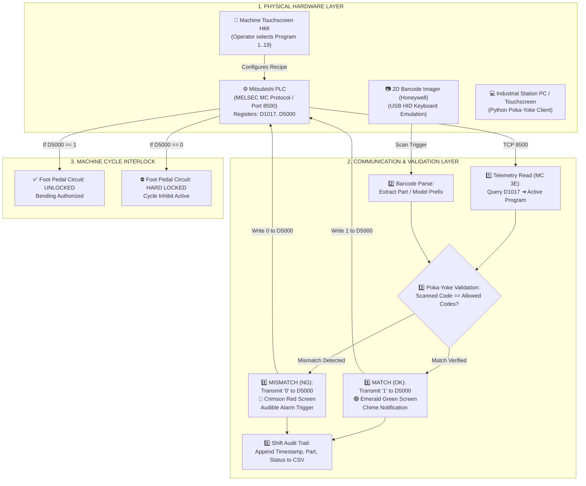

# Industrial Condenser Coil Bending — Poka-Yoke System

[](https://www.python.org/)
[-orange.svg)](https://www.mitsubishielectric.com/)
[](https://github.com/)
[](LICENSE)

An Industry 4.0 Error-Proofing (Poka-Yoke) system designed for automated HVAC condenser coil bending machinery. It establishes a real-time hardware handshake between a 2D industrial barcode imager and a Mitsubishi PLC (FX5U / iQ-F Series) over Ethernet (MC Protocol / SLMP 3E Binary).

---

## 📌 Problem Statement

HVAC condenser bending lines handle multiple coil variants across shifting production schedules. Each variant requires a precise bending angle (e.g., 100° to 115°), depth, and bend sequence configured on the machine HMI.

* **Risk:** Operator error loading an incorrect coil model under an active recipe causes immediate plastic deformation, resulting in catastrophic part scrap costing **₹10,000+ per piece**.
* **Solution:** A fail-safe electrical interlock prevents the machine from initiating a bending cycle until the physical coil label is scanned and verified against the live PLC recipe.

---

## 🏗️ System Architecture



---

## ✨ Key Features

* **Direct PLC Handshake (No Wiring Modifications):** Communicates natively with Mitsubishi PLCs over TCP/IP using MELSEC MC Protocol Type 3E Binary. No machine rewiring or warranty disruption.
* **Plug & Play Barcode Ingestion:** Supports standard industrial USB 2D imagers (Honeywell, Zebra, Datalogic) via USB HID keyboard mode with automatic field auto-focus.
* **Fail-Safe Safety Interlock:**
  * **MATCH (OK):** Transmits `1` to interlock register `D5000`, authorizing machine operation.
  * **MISMATCH (NG):** Enforces `0` in `D5000`, keeping the foot pedal disabled and sounding an audible alarm.
* **Auto-Relock Protection:** Automatically resets `D5000` to `0` after 20 seconds to prevent unauthorized successive cycles on a single scan.
* **Dynamic Master Recipe Engine:** Loads allowed part codes from `recipe_config.json` with hot-reloading support (no application restart required upon editing recipes).
* **Comprehensive Audit Trail:** Logs all transactions (Date, Time, Operator, Program, Serial, Status) to daily CSV files for traceability and scrap prevention metrics.

---

## 🛠️ Hardware Requirements

* **PLC:** Mitsubishi Electric MELSEC iQ-F / FX5U / Q / L Series with Ethernet interface.
* **Industrial PC / Workstation:** Any Windows 10/11 workstation, Mini-PC, or industrial touch panel.
* **2D Barcode Scanner:** Honeywell 1400g/1450g/1470g, Zebra DS2208, or equivalent USB HID 2D imager.
* **Network:** Local plant Ethernet LAN or static industrial Wi-Fi subnet.

---

## 🚀 Quick Setup & Installation

### 1. Clone the Repository
```bash
git clone https://github.com/<your-username>/industrial-plc-poka-yoke-system.git
cd industrial-plc-poka-yoke-system
```

### 2. Install Python Dependencies
```bash
pip install -r requirements.txt
```

### 3. Configure Network & Register Addresses
Copy the sample configuration file and configure your plant network parameters:
```bash
cp .env.example .env
```

Edit `.env`:
```env
PLC_IP=192.168.19.206
PLC_PORT=8500
REG_READ_PROG=D1017
REG_WRITE_PERMIT=D5000
AUTO_RELOCK_DELAY_SEC=20
```

### 4. Launch Application
Double-click `Start_Bending_PokaYoke.bat` or run directly via terminal:
```bash
python app_gui.py
```

* Press **`F11`** to enter full-screen industrial kiosk mode.
* Press **`Esc`** to exit full-screen mode.

---

## 📁 Repository Structure

```
├── app_gui.py                   # Industrial Touchscreen GUI Client
├── main_app.py                  # Headless / Console Interface Client
├── recipe_config.json           # Master Recipe Configuration (Hot-Reloadable)
├── Start_Bending_PokaYoke.bat   # Windows One-Click Kiosk Launcher
├── set_d5000.py                 # Manual Register Override Utility (Diagnostics)
├── step1_ping_test.py           # Network Layer 3 Ping Reachability Test
├── step2_tcp_connect_test.py    # Transport Layer 4 Port Availability Test
├── step3_read_registers.py      # Application Layer 7 MC Protocol Read Diagnostics
├── step4_write_register.py      # Application Layer 7 MC Protocol Write Diagnostics
├── step5_register_discovery.py  # Automated PLC Register Range Discovery Tool
├── README_FACTORY.md            # On-site Operations & Maintenance Manual
├── requirements.txt             # Python Package Dependencies
├── .env.example                 # Environment Variable Configuration Template
└── .gitignore                   # Excludes Sensitive Data, .env, and Logs
```

---

## 📄 License
This project is licensed under the MIT License — see the [LICENSE](LICENSE) file for details.
